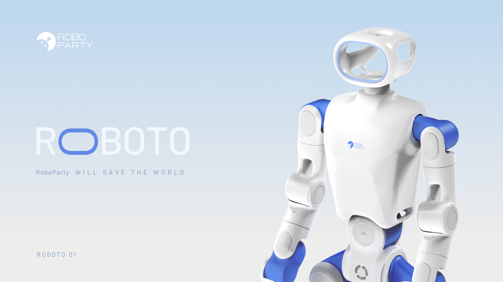
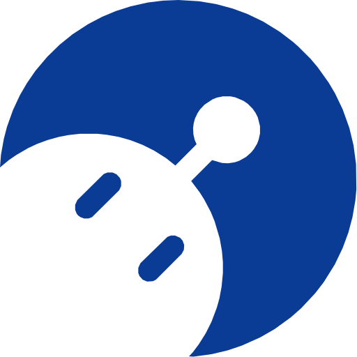
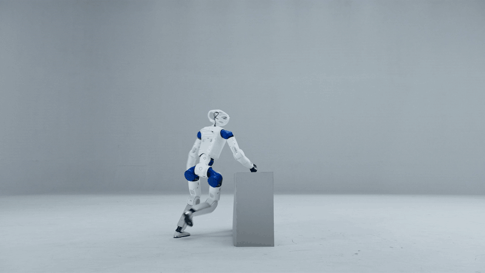
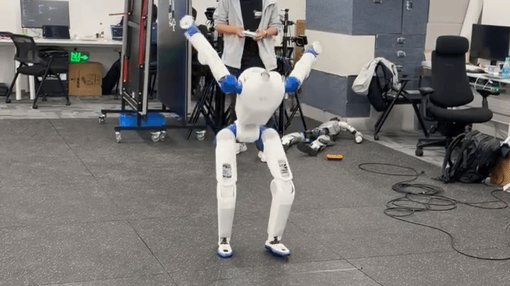
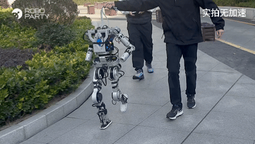
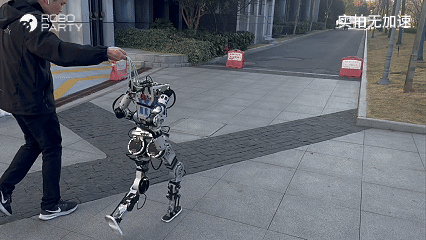
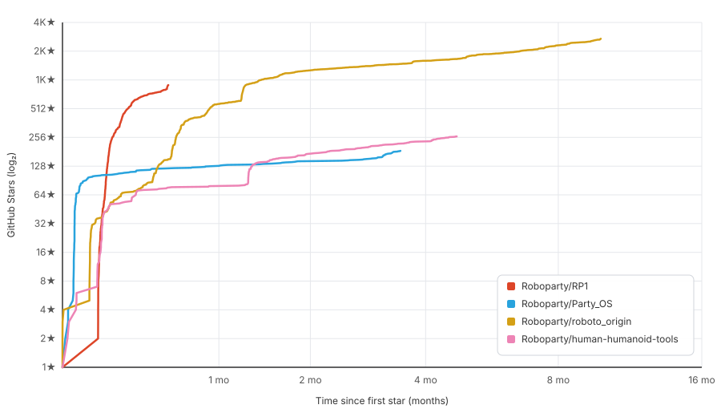

<a href="https://github.com/Roboparty/RP1">
  <picture>
    <source media="(max-width: 640px)" srcset="assets/1.jpg">
    
  </picture>
</a>

<h1 align="center">RoboParty </h1>

  Open hardware. Open intelligence. Shared possibility. · <a href="README.zh-CN.md">Chinese</a>

---

## Explore the Repositories  

### RP1: An Open Source Full-Stack Platform for Agentic Humanoids  

RP1 is RoboParty's fully open-source humanoid platform: a shared foundation for building, understanding and extending a real robot.

<table width="880">
  <tr>
    <td width="440"></td>
    <td width="440"></td>
  </tr>
</table>

### ROBOTO_ORIGIN / RPO  

RPO is RoboParty's full-stack open-source framework for humanoid robots, including hardware driver, motion control, algorithm modules and application development.

<table width="880">
  <tr>
    <td width="440"></td>
    <td width="440"></td>
  </tr>
</table>

### Party_OS. A Connected Stack.  

A Humanoid System built by [RoboParty_Lab](https://lab.roboparty.com/), an open R&D foundation for humanoid robots for global developers.

### human-humanoid-tools  

Retarget parkour, dance and interaction clips onto any humanoid in about 30 seconds.

---

<table width="100%">
  <tr>
    <td></td>
  </tr>
</table>

---

## About RoboParty 

RoboParty was founded on February 21, 2025. RoboParty builds full-stack, open-source humanoid robots—from hardware to code. 
Open robots. Endless possibilities. 
We believe robots will save the world.

<h3 align="center">Join the community, share your projects, and explore with RoboParty.</h3>

  
  
  
  
  

  
  
  
  
  

---

<h2 align="center">Contact</h2>

  
  
  

  Let robots become humanity's trusted partners.

  <a href="https://roboparty.com"><b>© RoboParty</b></a>

